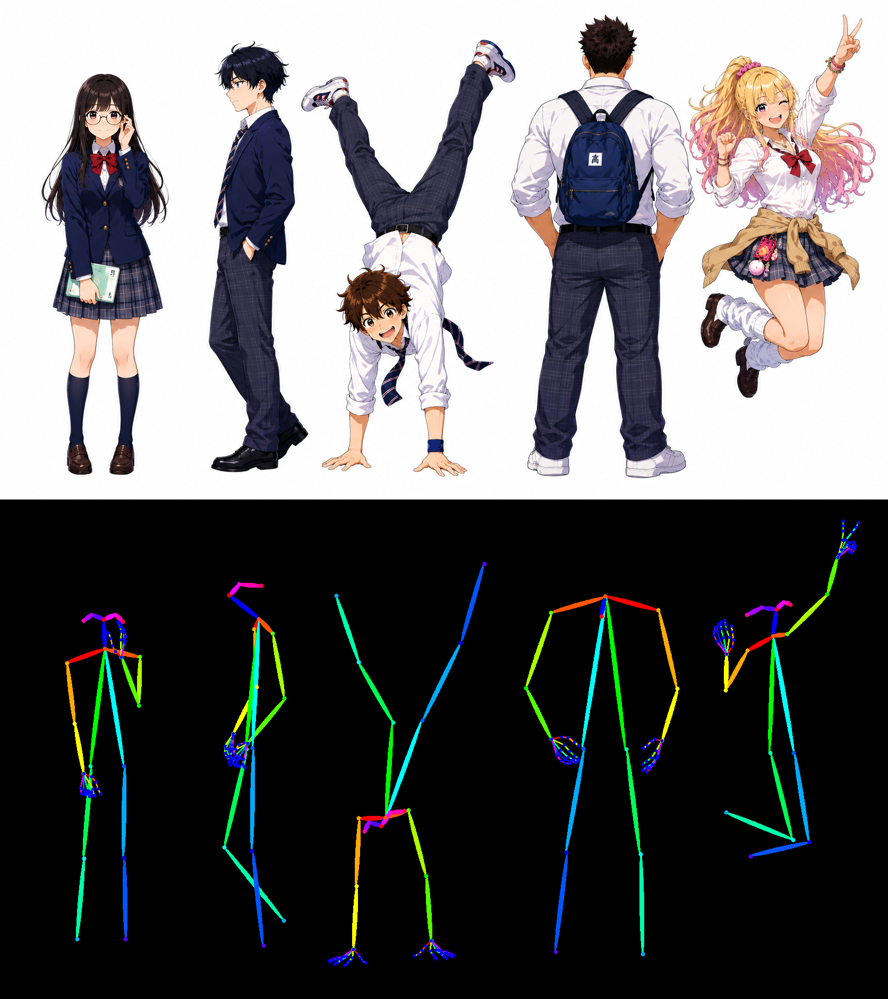
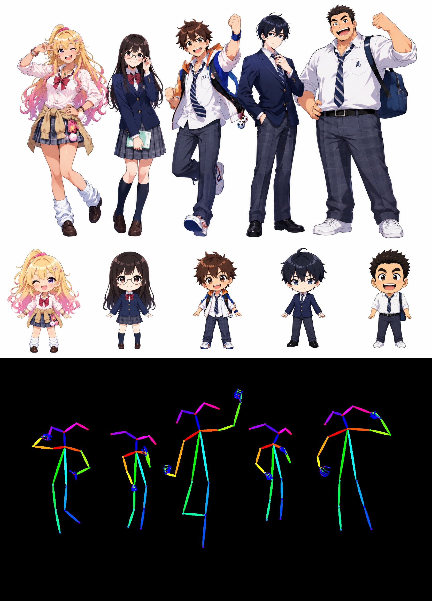
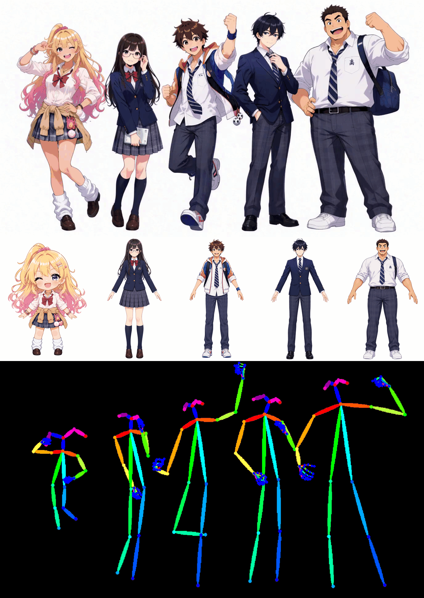

# ComfyUI-SAM3DBody-openpose-editor

[English](README.md) | [日本語](README.ja.md)

SAM3DBodyで画像内の人物の姿勢を推定し、OpenPose互換の `POSE_KEYPOINT` と画像として出力するComfyUIカスタムノードです。人物の検出とマスク分離にはSAM3.1を使います。複数人の入力と、人物ごとの体形リファレンスに対応しています。

## ノード

- `SAM3D Body OpenPose Analyze`
  - 必須入力: `pose_image`。任意入力: `body_shape_images`（単体画像・画像バッチ・Append出力）、`device`、`auto_head_proportion`、`person_threshold`。
  - 出力: `pose_keypoint`、`body_shape_keypoint`、`debug_person_crops`。
  - SAM3.1で人物ごとのbboxとマスクを取得し、その範囲でSAM3DBodyが姿勢を推定します。頭身調整には内部で顔の大きさを測りますが、出力画像に顔の詳細な点は描きません。
  - 複数人は検出されたbboxの左上順に並び、体形リファレンスもその順に割り当てられます。足りない・推定に失敗したリファレンスには、その人物のポーズ画像の体形を使います。余ったリファレンスは使いません。
  - `auto_head_proportion` を有効にして体形画像を接続すると、両画像で測った顔幅と胴体長の比率を人物ごとに反映します。ミニキャラのリファレンスでは胴体や手足を短くし、頭を元の最大2倍まで大きくします。顔の向きと表情はポーズ画像から引き継ぎます。顔幅を測れない場合は胴体長を基準に正規化します。
- `SAM3D Body OpenPose Video Analyze`
  - 動画読み込みノードから、フレーム順の `IMAGE` バッチを `pose_image` に接続します。`body_shape_images` は静止画版と同様に使えます。出力の2つのキーポイントを Render に接続すると、フレーム順の OpenPose 画像バッチが得られます。動画ファイルへの保存には、別途動画保存ノードを使います。
  - ComfyUI内蔵のSAM3.1動画追跡を使用します。同じフレームで最初に現れた人物には、bboxの左から右の順に追跡IDと体形リファレンスを割り当てます。その後は立ち位置が変わっても追跡マスクのIDを維持します。途中から現れた人物には次の未使用リファレンスが割り当てられます。検出できないフレームは空の骨格として出力します。`max_tracked_people` は追跡人数の上限、`detect_interval` は新しい人物を探す間隔です。
  - 必要ならComfyUI標準の `Run SAM3 Video Track` 出力を任意入力 `track_data` に接続できます。初期マスクや追跡プレビューを使う場合に便利です。この入力がある場合は、その追跡結果を優先します。
  - SAM3.1でも、急なカット、似た人物、長い遮蔽でIDが入れ替わる可能性があります。長い動画はメモリ使用量と処理時間を考慮して短いバッチに分けてください。バッチを分けると追跡IDはリセットされます。
- `SAM3D Body Shape Images (Append)`
  - Appendノードの `body_shape_image` に追加する画像を接続します。前段のAppendノードの `body_shape_images` を次の同名入力につなぐと、画像を1枚ずつ追加できます。必要な人数分つないだ後、最後の出力をAnalyzeの `body_shape_images` に接続してください。画像バッチはバッチ内の順番で追加されます。
- `SAM3D Body OpenPose Render`
  - 必須入力: `pose_keypoint`。任意入力: `body_shape_keypoint`。
  - 出力: OpenPose画像。体形リファレンスを接続した場合は、人物ごとに比率を適用して描画します。

`pose_keypoint` はCOCO-18の身体キーポイントとOpenPoseの21点の手キーポイントを含みます。`body_shape_keypoint` は同じOpenPose形式に加え、SAM3DBodyのMHR70・3D・パラメータ情報も含みます。

## ワークフローと画像例

基本的な使い方は [`workflows/sam3d_body_openpose_example.json`](workflows/sam3d_body_openpose_example.json) をComfyUIで開き、`Load Image` で入力画像を選択して実行します。Analyze → Render → Save Image の順に処理します。体形画像を1枚使う場合は別の `Load Image` をAnalyzeの `body_shape_images` につなぎます。複数枚ならAppendノードを人物の順につなぎ、最後の出力をAnalyzeの `body_shape_images` へ接続します。Analyzeの `body_shape_keypoint` 出力をRenderの同名入力につないでください。

### ポーズ推論の例

**上段が5人の入力画像、下段が推定したOpenPoseの骨格画像**です。入力画像から複数人の姿勢を抽出できることを示しています。

### 体形リファレンスの例

**上段がポーズ入力、中段が5人分のミニキャラ体形リファレンス、下段が体形を反映したOpenPose出力**です。各人物のポーズを保ちながら、対応するリファレンスの頭身に近づけられます。リファレンスは検出bboxの左上順で割り当てられるため、ポーズ画像で人物の並びが変わる場合は接続順も確認してください。この例のワークフローは [`workflows/sam3d_body_pose01_chibi01-05.json`](workflows/sam3d_body_pose01_chibi01-05.json) です。

### 動画と体形変更の例

**上段が動画のポーズ入力、中段が体形リファレンス、下段が人物を追跡して生成したOpenPose出力**です。GIFは5fpsで再生します。左端の人物にはミニキャラの体形リファレンスを適用しています。フレームが進んで立ち位置が変わっても、追跡IDにより同じ人物へ同じ体形を割り当てます。[動画サンプルのワークフロー](workflows/sam3d_body_pose01_chibi01_Video.json)を開き、動画と体形リファレンスを読み込みノードで指定してください。

## モデル

AnalyzeはComfyUIのモデルフォルダーから次のファイルを探し、存在しない場合に自動ダウンロードします。

- `models/sam3dbody/model.ckpt` と `models/sam3dbody/assets/mhr_model.pt` — [SAM3DBodyモデル](https://huggingface.co/jetjodh/sam-3d-body-dinov3)
- `models/sam3.1/sam3.1_multiplex_fp16.safetensors` — [SAM3.1モデル](https://huggingface.co/Comfy-Org/sam3.1)

Hugging FaceからのダウンロードがWindowsのエラー10054で失敗した場合は、別プロセスでIPv4接続を使って再試行します。それ以外のエラーはそのまま報告します。

SAM3.1が人物を検出できなかった場合はエラーを報告します。インストール済みのxFormersがGPUに対応していない場合は、SAM3.1の処理をPyTorch attentionで再試行します。
