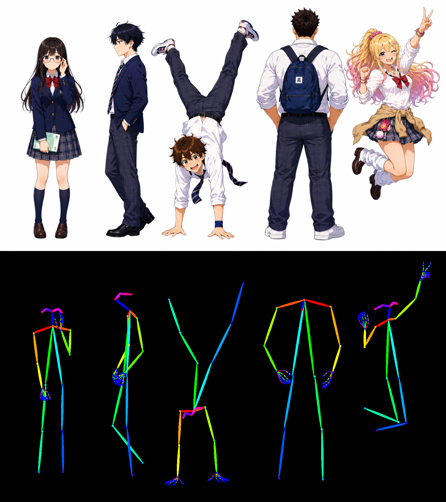
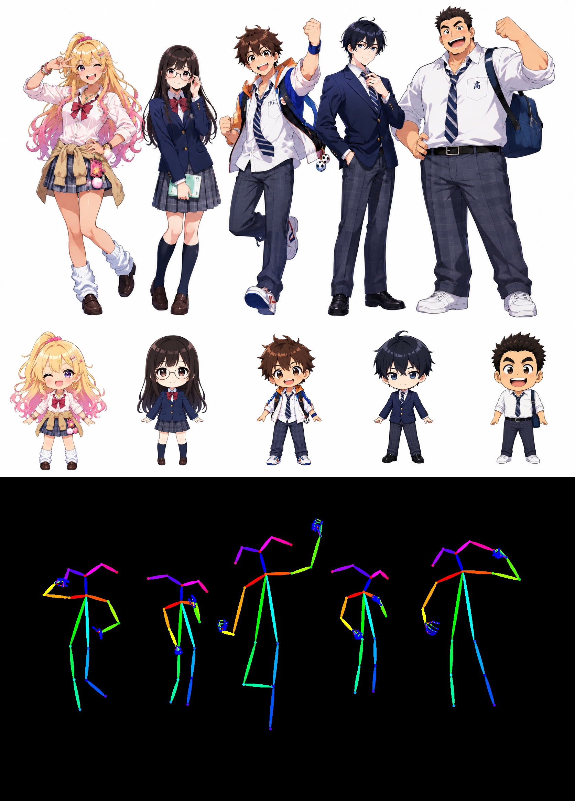

# ComfyUI-SAM3DBody-openpose-editor

[English](README.md) | [日本語](README.ja.md)

SAM 3D Body inference to OpenPose-compatible `POSE_KEYPOINT` data.

## Nodes

- `SAM3D Body OpenPose Analyze`
  - Inputs: required `pose_image`, optional `body_shape_image` or `body_shape_images`, `device`, `auto_head_proportion`, `person_threshold`
  - Outputs: `pose_keypoint`, `body_shape_keypoint`, `debug_person_crops`
  - With `auto_head_proportion` enabled and a body-shape image connected, SAM3.1 measures face width in both images. The reference's face-to-torso ratio is transferred per person: a chibi reference shortens the body and enlarges the pose head up to 2×. The pose's face direction and expression stay in place. When the reference face cannot be measured, body lengths are normalized by torso length.
  - SAM3.1 detects each person's box and mask. SAM3DBody estimates the pose within each mask. Face size is measured internally when adjusting body proportions; detailed face points are not drawn in the output image.
  - Multi-person images are supported. People are sorted by the top-left position of their detected bbox. Reference body shapes are assigned in that order. A single `body_shape_image`, an image batch, and a chained `body_shape_images` collection are supported. If both inputs are connected, `body_shape_image` comes first. Missing or failed reference slots use the corresponding person from `pose_image`; extra references are ignored.
  - Render applies each reference person's body proportions separately. Reference keypoints are normalized to the pose person's scale and head points are aligned to that reference person's neck before measuring lengths.
- `SAM3D Body OpenPose Video Analyze`
  - Connect an ordered `IMAGE` frame batch from a video loader to `pose_image`. `body_shape_image` and `body_shape_images` work as in the still-image node. Connect both keypoint outputs to Render to obtain an ordered batch of OpenPose frames; use a separate video saver to write a video file.
  - The default `sam31_video` mode uses ComfyUI's native SAM3.1 video tracker. People receive IDs and reference slots in top-left bbox order when they first appear; subsequent frames keep the tracked mask IDs. A person entering later receives the next unused reference. Frames with no detected people produce an empty pose frame. `max_tracked_people` limits object count; `detect_interval` controls how often the tracker searches for new people.
  - You may connect `Run SAM3 Video Track` to the optional `track_data` input to use its initial masks and tracking preview. Connected track data takes precedence. Select `tracking_mode=frame_matching` for the previous position-and-color matcher; `max_missing_frames` applies only to that mode.
  - Abrupt cuts, similar-looking people, and long occlusion can still swap IDs. Split long videos into shorter batches to manage memory and processing time; IDs reset between batches.
- `SAM3D Body Shape Images (Append)`
  - Connect one `IMAGE` to `body_shape_image`. Connect a previous Append node's `body_shape_images` output to this node's `body_shape_images` input to add another reference. Chain as many Append nodes as needed, then connect the last output to Analyze's `body_shape_images` input. Each image batch contributes its frames in batch order.
- `SAM3D Body OpenPose Render`
  - Inputs: required `pose_keypoint`, optional `body_shape_keypoint`
  - Outputs: rendered OpenPose image

`pose_keypoint` uses COCO-18 body order plus OpenPose 21-point hands.
`body_shape_keypoint` includes the same OpenPose structure plus raw SAM3DBody MHR70 / 3D / parameter data for downstream retargeting.

## Sample workflow

Load [`workflows/sam3d_body_openpose_example.json`](workflows/sam3d_body_openpose_example.json) in ComfyUI, select an image in `Load Image`, then queue the workflow. It runs Analyze → Render → Save Image. For one body-shape reference, connect another `Load Image` node to Analyze's `body_shape_image` input. For multiple references, chain `SAM3D Body Shape Images (Append)` nodes in person order and connect the last output to Analyze's `body_shape_images` input. Connect Analyze's `body_shape_keypoint` output to Render's matching input. The node uses `models/sam3.1/sam3.1_multiplex_fp16.safetensors` if present and downloads it automatically on first use.

### Pose estimation example

The **top** of the image is the input with five people. The **bottom** is the OpenPose skeleton output estimated from that input.

### Body-shape reference example

The **top row** is the pose input. The **middle row** shows five chibi body-shape references. The **bottom row** is the output: it keeps the input poses while changing each person's body proportions toward the corresponding reference. References are assigned in detected bbox order, from the top-left person onward. The workflow is [`workflows/sam3d_body_pose01_chibi01-05.json`](workflows/sam3d_body_pose01_chibi01-05.json).

## Models

Analyze looks for these files under ComfyUI's configured models directory and downloads them automatically when missing:

- `models/sam3dbody/model.ckpt` and `models/sam3dbody/assets/mhr_model.pt`
  - Source: https://huggingface.co/jetjodh/sam-3d-body-dinov3
- `models/sam3.1/sam3.1_multiplex_fp16.safetensors`
  - Source: https://huggingface.co/Comfy-Org/sam3.1

If a Hugging Face download fails with Windows error 10054, the node retries that download over IPv4 in a separate process. Other download errors are reported normally.

If SAM3.1 finds no people, Analyze reports an error. On GPUs unsupported by the installed xFormers build, SAM3.1 retries with PyTorch attention automatically.
